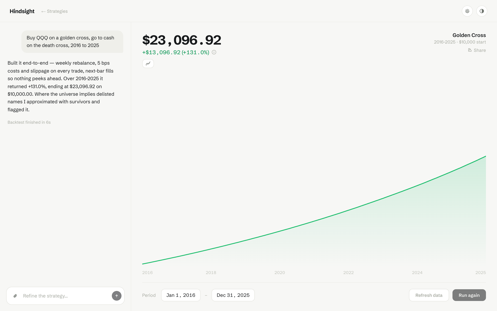
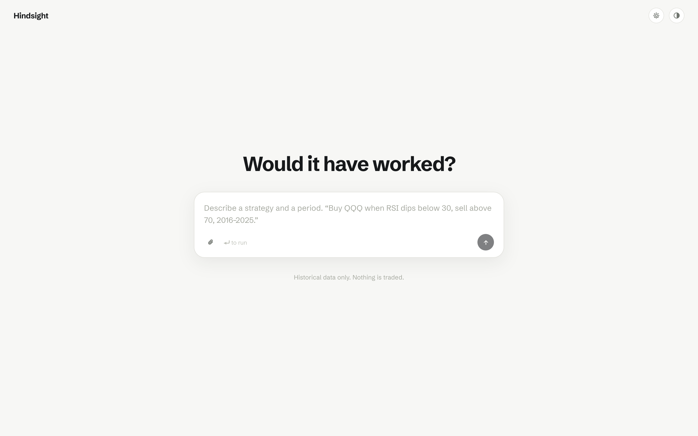
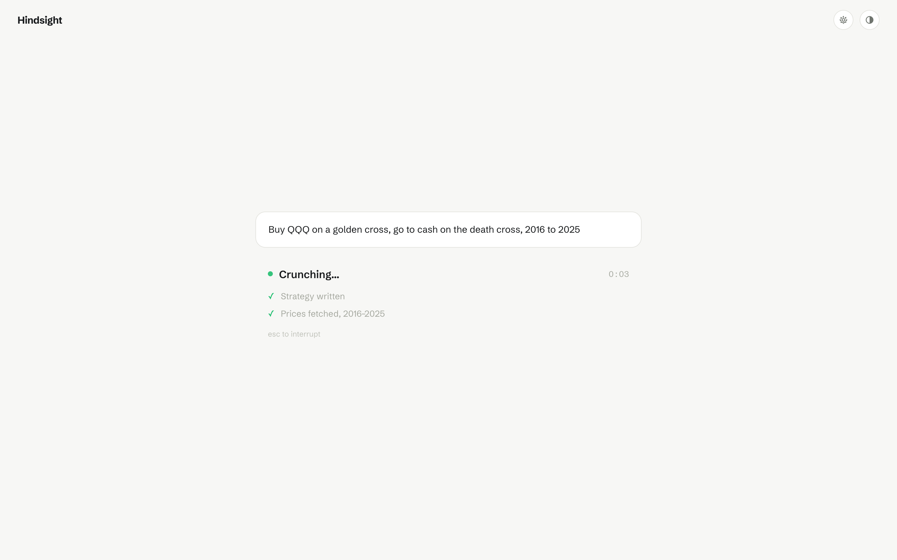
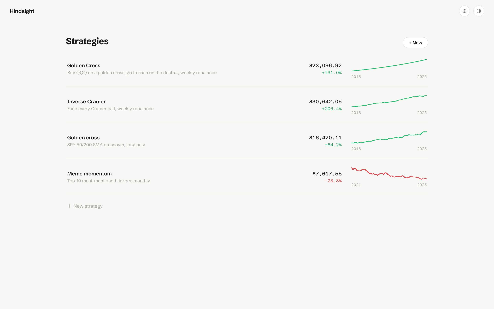
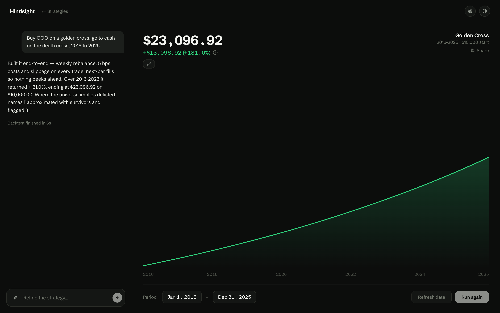

# Hindsight

**[hindsight.build](https://hindsight.build)** · A local, single-user **AI
investment-strategy backtester**. Describe a strategy and a period in plain English;
an agent writes and runs a real backtest on historical data, streams its progress,
and returns an equity curve you can refine by chatting.

> Historical data only. Nothing is traded.

<p align="center">
  
</p>

<table>
  <tr>
    <td></td>
    <td></td>
  </tr>
  <tr>
    <td></td>
    <td></td>
  </tr>
</table>

## Quick start

Requires **[Bun](https://bun.sh) 1.x** and **Node ≥ 20.9** (Next.js runs on Node).

```bash
bun install
bun run seed       # optional: load the three example strategies
bun run dev        # http://localhost:3000   (or: bun run build && bun run start)
```

`bun run dev` starts two processes: the **API server** (a small Bun server on
`127.0.0.1:8787` that owns all state) and the **web UI** (Next.js on `:3000`, which
forwards `/api/*` to it). The [iPhone app](#iphone-app) talks to the same API server.

By default Hindsight runs the **mock agent** — an in-process, procedural backtester that
needs no Docker or API keys. The whole app is fully usable and demoable this way. To run
**real** backtests, enable the Codex + Docker agent (below). In Codex mode, `bun run dev`
checks that Docker is available and builds the local agent image before starting Next.js;
unchanged image layers are reused from Docker's build cache.

## Two agent backends

Selected by `HINDSIGHT_AGENT` (see `.env.example`):

| Mode | What it does | Requirements |
|------|--------------|--------------|
| `mock` (default) | Streams a believable run and returns a deterministic, seeded equity curve. Great for UI/demo/offline. | none |
| `codex` | Spawns a **Docker container per run** that runs `codex exec` (or Claude Code, for a Claude model); the agent writes real Python, fetches/scrapes whatever data the strategy needs, and runs a realistic backtest. | Docker daemon running, Codex CLI auth in `~/.codex` and/or a Claude token (below) |

### Enabling the real (Codex) backend

```bash
# ensure the Docker daemon is running and you're logged into Codex CLI (~/.codex)
HINDSIGHT_AGENT=codex bun run dev
```

### Claude Code as a second agent

The same container can run [Claude Code](https://claude.com/claude-code) instead of Codex.
Which agent a run uses follows from its **model**: pick a Claude model in Settings (or for
one strategy) and that run goes to `claude -p`; pick a GPT model and it goes to `codex exec`.
Both write the same files under the same instructions (`docker/AGENTS.md`).

```bash
claude setup-token                      # a long-lived token for your Claude subscription
mkdir -p ~/.config/hindsight && chmod 700 ~/.config/hindsight
# save the token (one line) as ~/.config/hindsight/claude-oauth-token, mode 600
```

An Anthropic API key in that file works too. The file is mounted read-only into the
container; with none, no Claude models are offered. The models themselves are listed live:
Codex's from `codex debug models`, Claude's from Anthropic's Models API (`GET /api/models`).

`bun run docker:build` remains available when you want to build the agent image manually,
including before a production `bun run start`.

If Codex isn't signed in on the host, the app says so instead of failing mid-run: the
empty-state composer is disabled with "Codex is not signed in on this machine." plus the
`codex login` hint, and `POST /api/sessions` / `POST …/messages` return **503**. Readiness
comes from `GET /api/health` (re-checked when the tab regains focus, so logging in from a
terminal unblocks the composer without a reload).

Each run mounts a per-session working directory into the container and runs the agent
with `codex exec --dangerously-bypass-approvals-and-sandbox` (safe because the container
*is* the sandbox — network on, isolated FS, torn down after the run). The agent follows
[`docker/AGENTS.md`](docker/AGENTS.md), which encodes the realism rules and the file
protocol it must obey.

## How it works

```
Browser (React) ─▶ Next.js (UI + front-door gate) ─┐
                                                   ├─HTTP─▶ Bun API server ──▶ Run manager
iPhone app (Exact) ──── HTTPS over your tailnet ───┘          ▲                    │
     ▲                                                        │                    ▼
     └──── SSE (/stream) or polling (/api/mobile) ◀── progress frames   AgentRunner (mock | codex-in-Docker)
                                                                                   │  events.ndjson + result.json
                                                                                   ▼
                                                                    Session store (JSON files on disk)
```

- **One backend.** `server/` is a standalone Bun server (`Bun.serve`, no framework) that
  owns the session store, live runs, SSE, sharing and signal scheduling. Next.js serves
  only the React UI and forwards `/api/*` and `/share/*` to it; the iPhone app calls it
  directly. Nothing else touches `./data/`.

- **One session per strategy.** Sessions persist as JSON under `./data/` and appear in the
  list. *Results persist; a run in flight when the server restarts is marked failed* (no
  reattach — a deliberate v1 choice).
- **Streaming.** The run manager parses the agent's structured progress into Server-Sent
  Events; the UI renders the live "Working" view (steps, elapsed, whimsical status words),
  then transitions to the chart + chat "Expanded" view.
- **Re-runs reuse code.** Changing the dates ("Run again") re-executes the saved strategy
  over the new range with no LLM call. "Refresh data" clears the per-session data snapshot
  and re-fetches. Chat refinements include the full conversation and previous accepted
  result; improvement requests compare candidates with that baseline instead of silently
  accepting a regression. Every completed version gets a copyable `BT-###` id; paste one
  into chat to branch from that exact archived code and result.
- **Images.** Attach, paste, or drop up to 4 images (PNG/JPEG/WebP/GIF, 10 MB each) on a
  new strategy or a refinement — a chart to match, a table of weights, a screenshot. They're
  handed to Codex with `codex exec -i`, so the agent genuinely sees them. In chat an image
  with no text is a valid message; a new strategy still needs a prompt. (The mock agent
  stores and shows them but can't read them.)
- **Compare.** Every successful response reassesses and stores a meaningful comparable
  asset (for example, QQQ for a technology strategy). The server validates it against
  that exact `BT-###` strategy and its available price history whenever the dashed
  buy-and-hold line loads—including while viewing an older version. It is shown by
  default and can be hidden with the small toggle under the return.
- **Enforced realism.** Every real backtest uses adjusted (total-return) prices, applies
  transaction costs + slippage, models short borrow, and avoids lookahead / survivorship
  bias. See [`PROTOCOL.md`](PROTOCOL.md) §5 and [`docker/AGENTS.md`](docker/AGENTS.md).
- **Sharing.** The Share button mints a secret link and exposes it through a
  [`cloudflared`](https://developers.cloudflare.com/cloudflare-one/connections/connect-networks/downloads/)
  quick tunnel (install it separately; the dialog tells you if it's missing). Tunnel
  visitors can reach exactly one thing — a static, read-only, no-JavaScript HTML page for
  the shared strategy. `proxy.ts` 404s everything else (the app, the API, all assets) for
  any request that arrives through a tunnel. Revoking the share kills the link instantly.
- **Activation.** Activate a finished strategy and it becomes a live signal feed: its
  saved code is re-executed on a schedule derived from the strategy itself (asset class +
  rebalance frequency — no LLM involved), and when the target positions change on the
  latest bar you get a text with the BUY/SELL deltas. Delivery is pluggable via
  `HINDSIGHT_SIGNAL_PROVIDER` (see `.env.example`): a self-hosted Signal bot
  (`signal`, recommended — messages arrive as a real conversation from a dedicated
  number), Apple Messages via `osascript` (`imessage`, default), a Poke.com key, or a
  generic webhook bridge. `HINDSIGHT_SIGNAL_PHONE` sets the default recipient. Still
  simulation output — nothing is traded.

## Configuration

Copy `.env.example` → `.env` and adjust:

| Var | Default | Meaning |
|-----|---------|---------|
| `HINDSIGHT_AGENT` | `mock` | `mock` or `codex` |
| `HINDSIGHT_DOCKER_IMAGE` | `hindsight-agent:latest` | image for real runs |
| `HINDSIGHT_CODEX_HOME` | `~/.codex` | Codex auth mounted (read-only) into the container |
| `HINDSIGHT_CODEX_MODEL` | `gpt-5.6-sol` | model passed to `codex exec -m` until one is chosen in Settings |
| `HINDSIGHT_CODEX_BIN` | `codex` | host Codex CLI asked for the models on offer (`codex debug models`) |
| `HINDSIGHT_CLAUDE_TOKEN_FILE` | `~/.config/hindsight/claude-oauth-token` | Claude Code's credential (a `claude setup-token` token or an API key), mounted read-only into the container |
| `HINDSIGHT_DATA_DIR` | `./data` | session store + per-session workdirs |
| `HINDSIGHT_SIGNAL_PROVIDER` | `imessage` | signal delivery: `imessage`, `signal`, `poke`, or `webhook` |
| `HINDSIGHT_SIGNAL_PHONE` | — | default recipient (E.164) for buy/sell signal messages |
| `HINDSIGHT_SIGNAL_CLI_URL` | — | `signal` provider: base URL of the signal-cli-rest-api service |
| `HINDSIGHT_SIGNAL_SENDER` | — | `signal` provider: bot number (E.164) messages are sent from |
| `HINDSIGHT_SIGNAL_CLI_AUTH` | — | `signal` provider: optional `Authorization` header value |
| `HINDSIGHT_POKE_API_KEY` | — | API key for the `poke` provider |
| `HINDSIGHT_SIGNAL_WEBHOOK_URL` | — | target URL for the `webhook` provider |
| `HINDSIGHT_API_PORT` | `8787` | port of the API server (bound to `HINDSIGHT_API_HOST`, default `127.0.0.1`) |
| `HINDSIGHT_API_URL` | `http://127.0.0.1:8787` | where the web UI forwards `/api/*` and `/share/*` |
| `HINDSIGHT_WEB_ORIGIN` | *(from the request)* | the web UI's origin, which a share tunnel exposes |
| `HINDSIGHT_TAILNET_PORT` | *(unset)* | second API listener for the iPhone app, behind `tailscale serve` — see [iPhone app](#iphone-app) |
| `HINDSIGHT_TAILNET_USERS` | *(any tailnet user)* | comma-separated tailnet logins allowed on that listener |
| `HINDSIGHT_AUTH_USER` | *(unset)* | username for Basic auth — see [Hosting it on a domain](#hosting-it-on-a-domain) |
| `HINDSIGHT_AUTH_PASSWORD` | *(unset)* | password for Basic auth; **both** must be set for auth to switch on |

## Hosting it on a domain

Hindsight is built to run locally, and out of the box it has no authentication — anyone
who can reach it can spend your Codex credits. If you want it on a public domain anyway,
set **both** auth vars:

```bash
HINDSIGHT_AUTH_USER=you
HINDSIGHT_AUTH_PASSWORD="$(openssl rand -base64 24)"
```

That flips the front-door gate ([`lib/gate.ts`](lib/gate.ts), applied by both
[`proxy.ts`](proxy.ts) and the API server) out of its local "tunnel gate" mode into **lockdown
mode**: every path — the app, the whole API, `/_next` assets — returns `401` until the
browser presents those credentials. The one exception is `/share/<token>`, which stays
public, so share links keep working for whoever you send them to.

Both vars must be non-empty; setting only one leaves auth **off**, so a half-finished
config can't silently open the door. Serve it over HTTPS (behind Caddy, nginx, or a
Cloudflare tunnel) — Basic credentials go out on every request.

One shared password is the floor, not the ceiling. For per-person identity, SSO, and no
publicly-reachable port at all, put **Cloudflare Access** (free up to 50 users) or
Tailscale in front; the Basic auth here composes fine underneath either.

> Auth stops strangers; it does **not** cap spend. Runs are tracked per session, so N
> sessions means N concurrent `codex exec` containers, and runs have no wall-clock cap.

## iPhone app

[`mobile/`](mobile) is a native iPhone app written with [Exact](https://github.com/expo/exact):
the strategy list, a New Strategy sheet (with a brainstorm that shapes an idea into a
strategy before anything is backtested), Settings for the model, and for each strategy a chat thread with live run
progress and a composer, under the result: an equity curve you can drag across, compared
with its benchmark, that expands to a full screen with the headline figures. Its view is `mobile/app.contract`, its data module `mobile/app.ts`, and it
talks to the same API server as the web UI, using the compact `/api/mobile/*` views
(PROTOCOL.md §6) to read and the regular routes to write.

The phone reaches the server **over your tailnet, never the public internet**:

```bash
# on the machine that runs Hindsight (once)
HINDSIGHT_TAILNET_PORT=8788 bun run api                    # or put the var in .env.local
tailscale serve --bg --https=8443 http://127.0.0.1:8788    # HTTPS, tailnet devices only
```

`tailscale serve` terminates TLS with your machine's `*.ts.net` certificate and stamps every
request with the caller's tailnet identity; the listener refuses anything without one, so
there is no password to type on the phone. Then build and install the app:

```bash
cd mobile
API_BASE_URL=https://<machine>.<tailnet>.ts.net:8443 tools/ship.sh   # prints an AppDrop link
```

`tools/ship.sh` builds the IPA with [exact build](https://exact.appdrop.app) (no Mac
needed) and publishes it with [AppDrop](https://appdrop.app); open the link on the iPhone to
install (with Tailscale's VPN off while AppDrop pairs and installs, or `npx appdrop relay`
running on a tailnet machine; turn Tailscale back on to use the app).

Working on the app needs an [Exact](https://github.com/expo/exact) checkout beside this repo
(`../exact`, after `bun scripts/exact.mjs setup` there) and Chrome (`CHROME=/path/to/chrome`).
In `mobile/`, `bun exact.mjs verify` runs `app.test.contract` against the real API server with
the mock agent (`mobile/server.ts`), then checks every screen the tests end on.

## Project layout

```
app/                 Next.js App Router — the React UI (no server code)
server/               The Bun API server: index.ts (listeners), router.ts, routes/*
mobile/               The iPhone app (Exact): app.contract, app.ts, app.test.contract
components/           React UI
lib/                  Shared contract: types, format, chart math, tokens, theme, period
lib/gate.ts           Front-door policy shared by proxy.ts and the API server
lib/agent-runner.ts   The AgentRunner interface both backends implement
lib/client/           Client data layer: fetch helpers + SSE / session / theme hooks
lib/server/           Session store, run manager, and the agent layer
  agent/               mock runner, codex-in-Docker runner, prompt builder, mock curve
docker/               Image + AGENTS.md + entrypoint for real Codex runs
proxy.ts              Next's front door: applies lib/gate.ts to every web request
scripts/dev.mjs       Launcher: prepares the agent image when needed, runs the API + Next
scripts/seed.mjs      Seeds the three example strategies
tests/                bun test specs, one file per module (+ shared fixtures)
PROTOCOL.md           The binding API / SSE / agent-file contract
```

## Scripts

| Command | Description |
|---------|-------------|
| `bun run dev` | Prepare the agent image when needed, then start the API server + `next dev` |
| `bun run build` / `bun run start` | Production build, then the API server + `next start` |
| `bun run api` | The API server alone (what the iPhone app needs) |
| `bun run typecheck` | `tsc --noEmit` |
| `bun run lint` | ESLint |
| `bun run test` | `bun test` — the suite in `tests/` |
| `bun run seed` | Load the three example strategies |
| `bun run docker:build` | Build the agent container image |

## Tests

`bun test`. Bun's runner is built in, so the suite adds no dependencies; it runs
in ~15s and needs neither Docker nor network access. Coverage is concentrated on
the parts of the app that are contracts rather than pixels: the tunnel
gate, the API server end to end (both listeners, CORS, the phone views), the `events.ndjson` / `result.json` agent protocol (PROTOCOL.md §3/§4),
image-upload validation, the session store, and the shared chart/format math. See
[CONTRIBUTING.md](CONTRIBUTING.md#tests) for what is not covered yet.

## Notes & limits (v1)

- Single-user and local by default, with no auth — **don't expose it to the internet
  without setting `HINDSIGHT_AUTH_USER` / `HINDSIGHT_AUTH_PASSWORD`** (see
  [Hosting it on a domain](#hosting-it-on-a-domain) and [SECURITY.md](SECURITY.md)).
  State lives on your machine under `./data/`.
- Runs have no hard time cap — press `esc` to interrupt (kills the container in Codex mode).
- The mock's equity curves are procedurally generated placeholders; real Codex output
  replaces them with genuine backtests.
- Backtests are simulations over historical data. Nothing here is investment advice.

## Contributing & license

Contributions welcome — see [CONTRIBUTING.md](CONTRIBUTING.md). Security reports:
[SECURITY.md](SECURITY.md). Released under the [MIT License](LICENSE).
